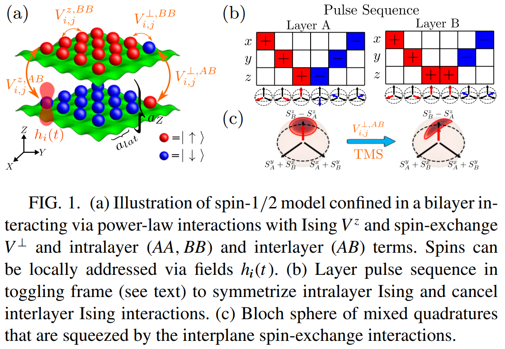
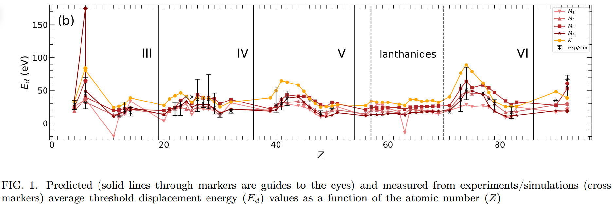
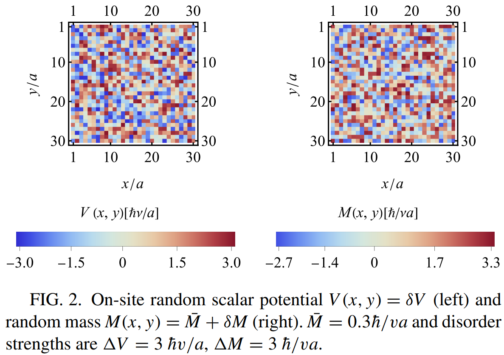

I am a computational physicist working at the intersection of quantum simulation, scientific computing, and machine learning. I build numerical models and simulation workflows to study complex physical systems, test analytical predictions, and connect model parameters to observable behavior. My work spans quantum many-body dynamics, electronic transport, and interpretable models for materials properties.

I am currently a postdoctoral researcher at Oklahoma State University, working with Thomas Bilitewski, and completed my Ph.D. in Physics at OSU in December 2025. My core research is on entanglement generation and quantum-enhanced sensing. Current projects also include Hamiltonian learning with graph and convolutional neural networks and resource-cost analysis for digital quantum simulation. I am interested in industry research roles where physics-based modeling, reliable numerical methods, and scientific machine learning help solve practical problems.

Technical Skills
======
- **Scientific programming:** Python, Julia, C/C++, Mathematica, MATLAB, Bash; NumPy, SciPy, Pandas, HDF5, Git, Linux
- **Numerical modeling:** Time evolution, differential equation solvers, exact diagonalization, semiclassical phase-space methods, Monte Carlo, finite-size scaling, and analytical benchmarks
- **High-performance computing:** Large-scale parameter sweeps, Slurm workflows, MPI, and GPU-accelerated C++ simulations
- **Scientific machine learning:** PyTorch, scikit-learn, GNN/CNN Hamiltonian learning, SISSO symbolic regression, random forests, and model validation
- **Quantum simulation and sensing:** Spin models, Floquet engineering, entanglement dynamics, spin squeezing, and Hamiltonian resource-cost modeling

Selected Projects
======

### Quantum dynamics and simulation at scale
I develop simulations of interacting spin systems to understand when useful entanglement can be generated and how it scales with system size. My work combines analytical spin-wave and Bogoliubov calculations with dTWA/GdTWA simulations, exact dynamics, and selected tensor-network benchmarks.

Research and methods

My doctoral work included simulations of approximately 20,000 interacting spins and the design of layer-selective Floquet pulse sequences for two-mode squeezing. I use Python and Julia workflows on HPC clusters for time evolution, parameter sweeps, and finite-size scaling. The emphasis is on checking approximations against analytical and numerical benchmarks, not just running larger simulations.  
Published results include <a href="https://doi.org/10.1103/PhysRevA.109.L061304">two-mode squeezing with Floquet-engineered interactions (PRA, 2024)</a>, <a href="https://doi.org/10.1103/7g55-lpff">nonequilibrium critical scaling (PRL, 2025)</a>, and <a href="https://doi.org/10.1103/py4q-klzp">universal squeezing transitions across lattice geometries and couplings (PRA, 2026)</a>. More recent collaborative work studies <a href="https://arxiv.org/abs/2610.02314">gap-protected squeezing in multilevel spins (preprint, 2026)</a>.

### Scientific machine learning
I work on learning physical parameters from data and building interpretable predictive models. Current GNN/CNN work focuses on inferring Hamiltonian parameters from quantum-system data. In materials research, I co-developed symbolic-regression models for threshold displacement energies, the energy needed to displace an atom from its lattice site.

Research and methods

The materials project used SISSO symbolic regression and random-forest comparisons to connect radiation-damage thresholds to material properties. We assessed predictive accuracy and found cohesive energy and melting temperature to be important descriptors. The work also identified limitations for more complex materials, where the available data did not support equally reliable predictions. See <a href="https://doi.org/10.1103/cf3q-b843">Physical Review Materials 9, 085002 (2025)</a>.  
Hamiltonian learning is ongoing research, rather than a deployed product. I am interested in models that can be checked against known physics and tested beyond their training conditions.

### Electronic transport and device modeling
I have modeled how disorder changes conductivity in two-dimensional Dirac systems and used numerical device simulation to explore lead-free tandem solar-cell designs.

Research and methods

For Dirac transport, I built GPU-accelerated C++ transfer-matrix simulations and studied the combined effects of scalar-potential and mass disorder. The resulting phase diagram distinguishes insulating, metallic, and scale-invariant transport regimes. See <a href="https://doi.org/10.1103/PhysRevB.110.094205">Physical Review B 110, 094205 (2024)</a>.  
In earlier device-modeling work, I used SCAPS to solve coupled electrostatics and carrier-transport equations and sweep optoelectronic parameters in a lead-free perovskite tandem solar cell. The optimized design reached <strong>30.85% simulated efficiency</strong>; this was a numerical result, not a fabricated-device measurement. See <a href="https://doi.org/10.1016/j.optmat.2021.111891">Optical Materials 123, 111891 (2022)</a>.

### Mathematical modeling with an engineering team
During a mathematical modeling internship at Nettle LLC in 2025, I developed an optimization model and computational prototype for high-volume data flow in a distributed real-time database. The project involved working directly with an engineering team to translate a practical systems problem into a mathematical model.

See my [publications](/publications/) for research papers and my [CV](/files/CV_Duha.pdf) for a fuller record of experience.
